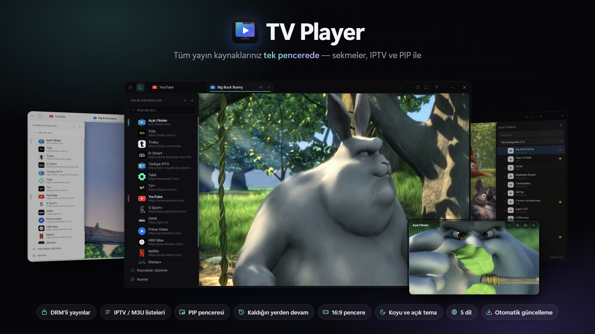

# TV Player

[Türkçe](README.md) · [English](README.en.md) · **Deutsch** · [Español](README.es.md) · [Italiano](README.it.md)

> Alle Streamingdienste, IPTV-Listen und Live-Sender in einem Fenster.

## Download

**[Neueste Version herunterladen →](https://github.com/heryerdeyim/tv-player-releases/releases/latest)**

- `TV-Player-Setup-x.y.z.exe`: Installationsprogramm; automatische Updates funktionieren nur mit dieser Version.
- `TV-Player-x.y.z-portable.exe`: portable Version, ohne Installation.

## Alle Streamingquellen in einem Fenster

Streamingplattformen, Sportdienste, Live-TV-Seiten, IPTV-Listen … Schluss mit einem eigenen Browser-Tab für jeden Dienst, ständigem Fenster-Anpassen und lästigen Menüs. **TV Player** vereint alles, was Sie schauen, in einem einzigen, für Video gemachten Fenster.

## Die wichtigsten Funktionen

- **Alle Quellen an einem Ort.** Beliebte Streamingdienste sind bereits eingerichtet. Jede Website lässt sich per Adresse hinzufügen, sortieren und bearbeiten; Logos und Farben werden automatisch erkannt.
- **Tabs.** Jede Quelle öffnet sich in einem eigenen Tab mit eigener Sitzung – einmal anmelden genügt. Tabs im Hintergrund werden automatisch stummgeschaltet.
- **DRM-geschützte Inhalte.** Dank Widevine-Unterstützung laufen geschützte Inhalte vieler Abodienste direkt in der App.
- **IPTV-Listen.** M3U- / M3U8-Listen als Quelle hinzufügen: Senderliste, Kategorien in Ihrer Sprache, Suche, Favoriten mit Export / Import und Senderwechsel per Tastatur.
- **PIP-Fenster.** Einen Stream in einem kleinen Fenster schauen, das immer im Vordergrund in der Bildschirmecke bleibt. Mehrere PIP-Fenster ordnen sich automatisch an, und beim Wechsel zwischen Tab und PIP **läuft das Video dort weiter, wo es war**.
- **Video vergrößern.** Mit einem Klick füllt der Player das ganze Fenster. Auf Wunsch blendet sich auch die Titelleiste aus und erscheint halbtransparent, sobald die Maus über dem Fenster ist.
- **Immer 16:9.** Egal an welcher Kante Sie das Fenster ziehen – der Videobereich bleibt 16:9, ohne schwarze Ränder.
- **Ganz nach Ihrem Geschmack.** Dunkles, helles oder System-Design, ein Rahmen mit abgerundeten Ecken, „Immer im Vordergrund“ und Zoom.
- **5 Sprachen.** Deutsch, Englisch, Türkisch, Spanisch und Italienisch; beim ersten Start wird die Systemsprache gewählt.
- **Aktualisiert sich selbst.** Neue Versionen werden im Hintergrund geladen und mit einem Klick installiert.
- **Tastaturfreundlich.** Schnellauswahl der Quelle (Strg+K), Tab-Tastenkürzel, geschlossenen Tab wieder öffnen; offene Tabs sind beim nächsten Start wieder da.

## Systemvoraussetzungen

Windows 10 / 11 (Installationsprogramm oder portable Version)

## Unterstützen

Wenn Ihnen TV Player gefällt, können Sie die Weiterentwicklung auf **Kreosus** unterstützen: <https://kreosus.com/tvplayer>

---

Die Videos in den Screenshots stammen aus den offenen Filmen des Blender Studio (Big Buck Bunny, CC-BY 3.0). Dieses Repository enthält nur die Versionsdateien (Quelle für automatische Updates); der Quellcode ist privat.
