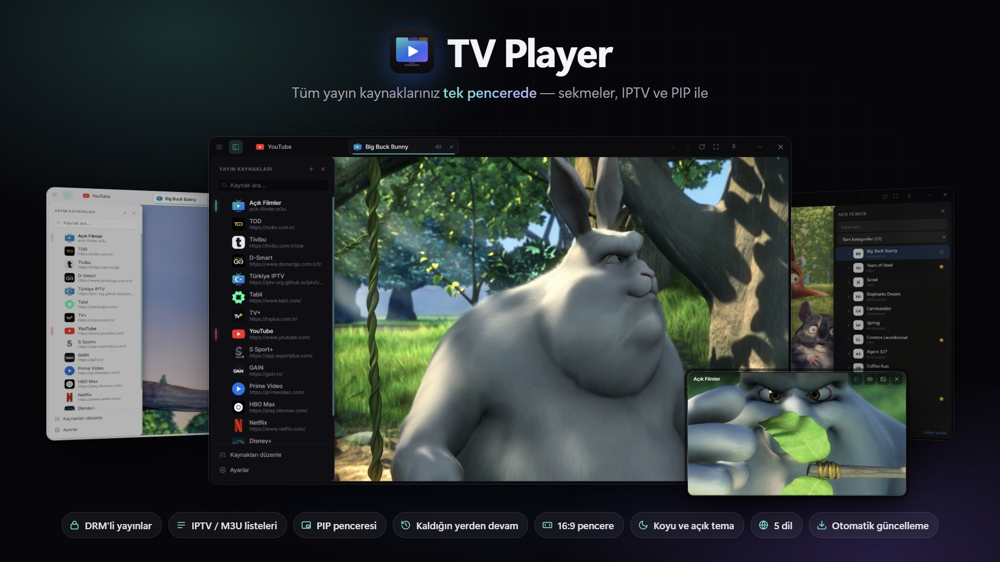

# TV Player

[Türkçe](README.md) · **English** · [Deutsch](README.de.md) · [Español](README.es.md) · [Italiano](README.it.md)

> All your streaming services, IPTV playlists and live channels in one window.

## Download

**[Download the latest version →](https://github.com/heryerdeyim/tv-player-releases/releases/latest)**

- `TV-Player-Setup-x.y.z.exe`: installer; automatic updates work only with this version.
- `TV-Player-x.y.z-portable.exe`: portable version, no installation needed.

## All your streaming sources in one window

Streaming platforms, sports services, live TV sites, IPTV playlists… No more juggling a separate browser tab for each one, resizing windows, or fighting with ads and menus. **TV Player** brings everything you watch together in a single window designed for video.

## Key features

- **Every source in one place.** Popular streaming services come preconfigured. Add any site by its address, reorder and edit your list; logos and colors are detected automatically.
- **Tabbed viewing.** Each source opens in its own tab with its own session, so you only sign in once. Background tabs are muted automatically.
- **DRM-protected content.** Thanks to Widevine support, protected content from many subscription services plays right inside the app.
- **IPTV playlists.** Add M3U / M3U8 playlists as sources: channel list, categories in your language, search, favorites with export / import, and keyboard channel switching.
- **PIP window.** Watch a stream in a small, always-on-top window in the corner of your screen. Multiple PIP windows line up automatically, and when you move between a tab and PIP, the video **picks up where you left off**.
- **Enlarge video.** One click makes the player fill the whole window. Optionally the title bar hides too, reappearing semi-transparent when the mouse is over the window.
- **Always 16:9.** Resize the window from any edge and the video area stays 16:9 — no black bars.
- **Make it yours.** Dark, light or system theme, a rounded inset frame, "always on top" mode and zoom.
- **5 languages.** English, Turkish, German, Spanish and Italian; the app picks your system language on first launch.
- **Updates itself.** New versions download in the background and install with one click.
- **Keyboard friendly.** Quick source picker (Ctrl+K), tab shortcuts, reopen closed tab; your open tabs come back next time.

## System requirements

Windows 10 / 11 (installer or portable version)

## Support the project

If you enjoy TV Player, you can support its development on **Kreosus**: <https://kreosus.com/tvplayer>

---

The videos in the screenshots are from Blender Studio's open movies (Big Buck Bunny, CC-BY 3.0). This repository only hosts release files (the automatic update source); the source code is private.
