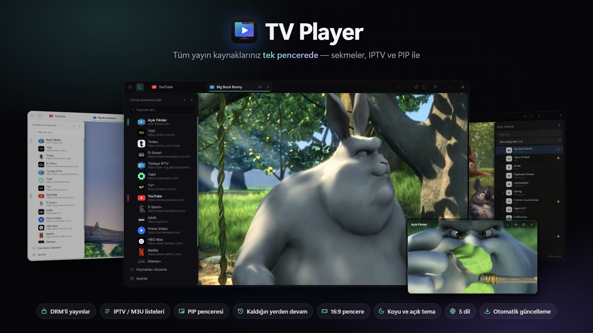

# TV Player

[Türkçe](README.md) · [English](README.en.md) · [Deutsch](README.de.md) · **Español** · [Italiano](README.it.md)

> Todos tus servicios de streaming, listas IPTV y canales en directo en una sola ventana.

## Descargar

**[Descargar la última versión →](https://github.com/heryerdeyim/tv-player-releases/releases/latest)**

- `TV-Player-Setup-x.y.z.exe`: instalador; las actualizaciones automáticas solo funcionan con esta versión.
- `TV-Player-x.y.z-portable.exe`: versión portátil, sin instalación.

## Todas tus fuentes de emisión en una sola ventana

Plataformas de series, servicios deportivos, webs de TV en directo, listas IPTV… Se acabó abrir una pestaña del navegador para cada uno, redimensionar ventanas y pelearse con anuncios y menús. **TV Player** reúne todo lo que ves en una sola ventana pensada para el vídeo.

## Funciones principales

- **Todas las fuentes en un solo lugar.** Los servicios de streaming más populares vienen ya configurados. Añade cualquier web por su dirección, ordénala y edítala; los logotipos y colores se detectan automáticamente.
- **Pestañas.** Cada fuente se abre en su propia pestaña con su propia sesión: solo tienes que iniciar sesión una vez. Las pestañas en segundo plano se silencian solas.
- **Contenido con DRM.** Gracias a la compatibilidad con Widevine, el contenido protegido de muchos servicios de suscripción se reproduce dentro de la aplicación.
- **Listas IPTV.** Añade listas M3U / M3U8 como fuente: lista de canales, categorías en tu idioma, búsqueda, favoritos con exportación / importación y cambio de canal con el teclado.
- **Ventana PIP.** Mira una emisión en una pequeña ventana siempre visible en una esquina de la pantalla. Varias ventanas PIP se colocan solas, y al pasar entre pestaña y PIP el vídeo **continúa donde lo dejaste**.
- **Ampliar vídeo.** Con un clic el reproductor ocupa toda la ventana. Si quieres, también se oculta la barra de título, que reaparece semitransparente al pasar el ratón sobre la ventana.
- **Siempre 16:9.** Redimensiona la ventana desde cualquier borde y el área de vídeo se mantiene en 16:9, sin bandas negras.
- **A tu gusto.** Tema oscuro, claro o del sistema, marco con esquinas redondeadas, modo «siempre visible» y zoom.
- **5 idiomas.** Español, inglés, turco, alemán e italiano; en el primer inicio se elige el idioma del sistema.
- **Se actualiza sola.** Las nuevas versiones se descargan en segundo plano y se instalan con un clic.
- **Pensada para el teclado.** Selector rápido de fuentes (Ctrl+K), atajos de pestañas y reabrir la pestaña cerrada; tus pestañas abiertas vuelven la próxima vez.

## Requisitos del sistema

Windows 10 / 11 (instalador o versión portátil)

## Apoya el proyecto

Si te gusta TV Player, puedes apoyar su desarrollo en **Kreosus**: <https://kreosus.com/tvplayer>

---

Los vídeos de las capturas proceden de las películas abiertas de Blender Studio (Big Buck Bunny, CC-BY 3.0). Este repositorio solo aloja los archivos de las versiones (fuente de actualizaciones automáticas); el código fuente es privado.
