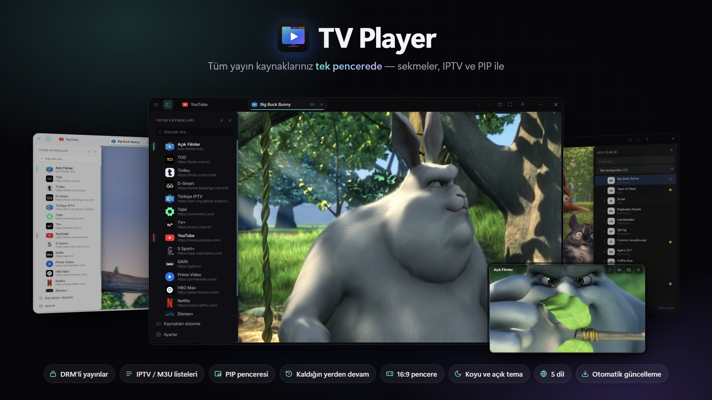

# TV Player

[Türkçe](README.md) · [English](README.en.md) · [Deutsch](README.de.md) · [Español](README.es.md) · **Italiano**

> Tutti i tuoi servizi di streaming, le liste IPTV e i canali in diretta in un'unica finestra.

## Download

**[Scarica l'ultima versione →](https://github.com/heryerdeyim/tv-player-releases/releases/latest)**

- `TV-Player-Setup-x.y.z.exe`: programma di installazione; gli aggiornamenti automatici funzionano solo con questa versione.
- `TV-Player-x.y.z-portable.exe`: versione portatile, senza installazione.

## Tutte le tue sorgenti di streaming in un'unica finestra

Piattaforme di serie, servizi sportivi, siti di TV in diretta, liste IPTV… Basta aprire una scheda del browser per ciascuno, ridimensionare finestre e combattere con pubblicità e menu. **TV Player** riunisce tutto ciò che guardi in un'unica finestra pensata per il video.

## Funzioni principali

- **Tutte le sorgenti in un solo posto.** I servizi di streaming più diffusi sono già configurati. Aggiungi qualsiasi sito tramite il suo indirizzo, riordinalo e modificalo; loghi e colori vengono rilevati automaticamente.
- **Schede.** Ogni sorgente si apre nella propria scheda con la propria sessione: basta accedere una volta. Le schede in background vengono silenziate automaticamente.
- **Contenuti protetti da DRM.** Grazie al supporto Widevine, i contenuti protetti di molti servizi in abbonamento si riproducono direttamente nell'app.
- **Liste IPTV.** Aggiungi liste M3U / M3U8 come sorgente: elenco dei canali, categorie nella tua lingua, ricerca, preferiti con esportazione / importazione e cambio canale da tastiera.
- **Finestra PIP.** Guarda una trasmissione in una piccola finestra sempre in primo piano nell'angolo dello schermo. Più finestre PIP si dispongono da sole e, passando da scheda a PIP e viceversa, il video **riprende da dove era rimasto**.
- **Ingrandisci video.** Con un clic il lettore occupa tutta la finestra. Se vuoi, si nasconde anche la barra del titolo, che riappare semitrasparente quando il mouse è sulla finestra.
- **Sempre 16:9.** Ridimensiona la finestra da qualsiasi bordo: l'area video resta 16:9, senza bande nere.
- **Come piace a te.** Tema scuro, chiaro o di sistema, cornice con angoli arrotondati, modalità «sempre in primo piano» e zoom.
- **5 lingue.** Italiano, inglese, turco, tedesco e spagnolo; al primo avvio viene scelta la lingua del sistema.
- **Si aggiorna da sola.** Le nuove versioni si scaricano in background e si installano con un clic.
- **Pensata per la tastiera.** Selezione rapida della sorgente (Ctrl+K), scorciatoie per le schede e riapertura della scheda chiusa; le schede aperte tornano al prossimo avvio.

## Requisiti di sistema

Windows 10 / 11 (programma di installazione o versione portatile)

## Sostieni il progetto

Se TV Player ti piace, puoi sostenerne lo sviluppo su **Kreosus**: <https://kreosus.com/tvplayer>

---

I video negli screenshot provengono dai film open di Blender Studio (Big Buck Bunny, CC-BY 3.0). Questo repository ospita solo i file delle versioni (fonte degli aggiornamenti automatici); il codice sorgente è privato.
