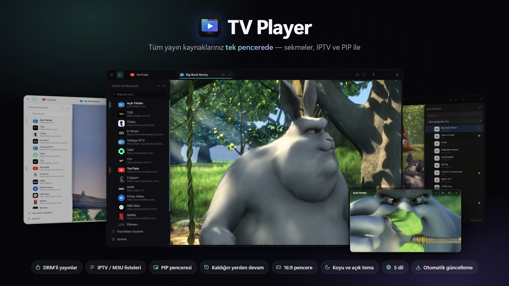

# TV Player

**Türkçe** · [English](README.en.md) · [Deutsch](README.de.md) · [Español](README.es.md) · [Italiano](README.it.md)

> Tüm yayın servisleriniz, IPTV listeleriniz ve canlı kanallarınız tek pencerede.

## İndir

**[Son sürümü indir →](https://github.com/heryerdeyim/tv-player-releases/releases/latest)**

- `TV-Player-Setup-x.y.z.exe`: kurulum sihirbazı; otomatik güncelleme yalnızca bu sürümde çalışır.
- `TV-Player-x.y.z-portable.exe`: kurulumsuz, taşınabilir sürüm.

## Tüm yayın kaynaklarınız tek pencerede

Dizi platformları, spor servisleri, canlı TV siteleri, IPTV listeleri… Her biri için ayrı bir tarayıcı sekmesi açmaya, pencereleri yeniden boyutlandırmaya, reklam ve menülerle uğraşmaya son. **TV Player**, izlediğiniz her şeyi video için tasarlanmış tek bir pencerede toplar.

## Öne çıkan özellikler

- **Tüm kaynaklar tek yerde.** Sık kullanılan yerli ve yabancı yayın servisleri hazır gelir. Dilediğiniz siteyi adresiyle ekleyebilir, sıralayabilir, düzenleyebilirsiniz; logo ve renkler otomatik bulunur.
- **Sekmeli izleme.** Her kaynak kendi sekmesinde, kendi oturumuyla açılır; bir kez giriş yapmanız yeterli. Arka plandaki sekmeler kendiliğinden sessize alınır.
- **DRM'li içerik desteği.** Widevine desteği sayesinde birçok abonelik servisinin korumalı içeriği uygulamanın içinde oynar.
- **IPTV listeleri.** M3U / M3U8 listelerini kaynak olarak ekleyin: kanal listesi, Türkçe kategoriler, arama, favoriler ve favorileri dışa / içe aktarma, klavyeyle kanal değiştirme.
- **PIP penceresi.** Bir yayını ekranın köşesinde, her zaman üstte duran küçük bir pencerede izleyin. Birden fazla PIP penceresi kendiliğinden yan yana dizilir; sekmeden PIP'e ya da PIP'ten sekmeye geçerken video **kaldığı yerden devam eder**.
- **Videoyu büyüt.** Tek tıkla oynatıcı pencerenin tamamını kaplar. İsterseniz başlık çubuğu da gizlenir; fare pencerenin üzerine gelince yarı saydam olarak belirir.
- **Her zaman 16:9.** Pencere hangi kenardan boyutlandırılırsa boyutlandırılsın video alanı 16:9 kalır, siyah boşluk oluşmaz.
- **Kendi zevkinize göre.** Koyu, açık ya da sisteme uyan tema; oval köşeli çerçeve; "her zaman üstte" modu ve yakınlaştırma.
- **5 dil.** Türkçe, İngilizce, Almanca, İspanyolca ve İtalyanca; ilk açılışta sisteminizin dilini seçer.
- **Kendiliğinden güncellenir.** Yeni sürümler arka planda iner, tek tıkla kurulur.
- **Klavye dostu.** Hızlı kaynak seçimi (Ctrl+K), sekme kısayolları, kapatılan sekmeyi geri açma; açık sekmeler bir sonraki açılışta geri gelir.

## Sistem gereksinimi

Windows 10 / 11 (kurulum ya da taşınabilir sürüm)

## Destek olun

TV Player'ı beğendiyseniz geliştirilmesine **Kreosus** üzerinden destek olabilirsiniz: <https://kreosus.com/tvplayer>

---

Ekran görüntülerindeki videolar Blender Studio'nun açık filmlerindendir (Big Buck Bunny, CC-BY 3.0). Bu depo yalnızca sürüm dosyalarını barındırır (otomatik güncelleme kaynağı); kaynak kod özeldir.
